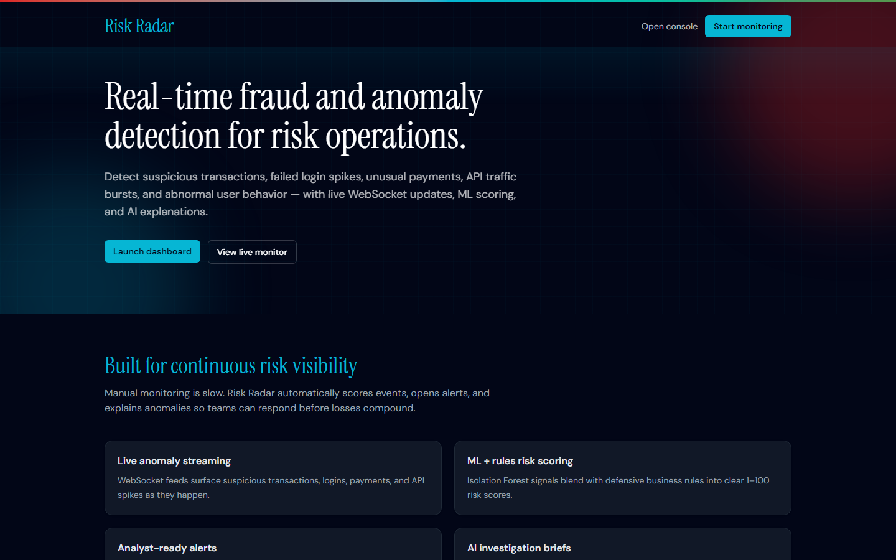
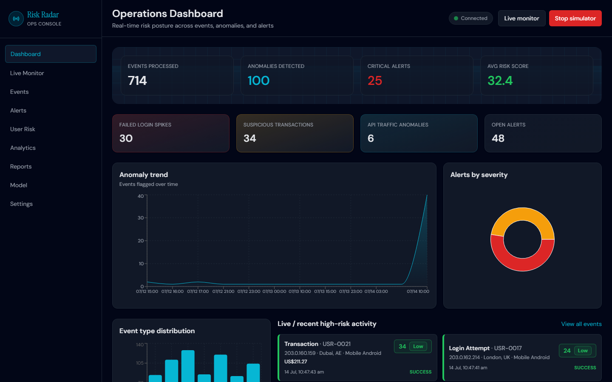
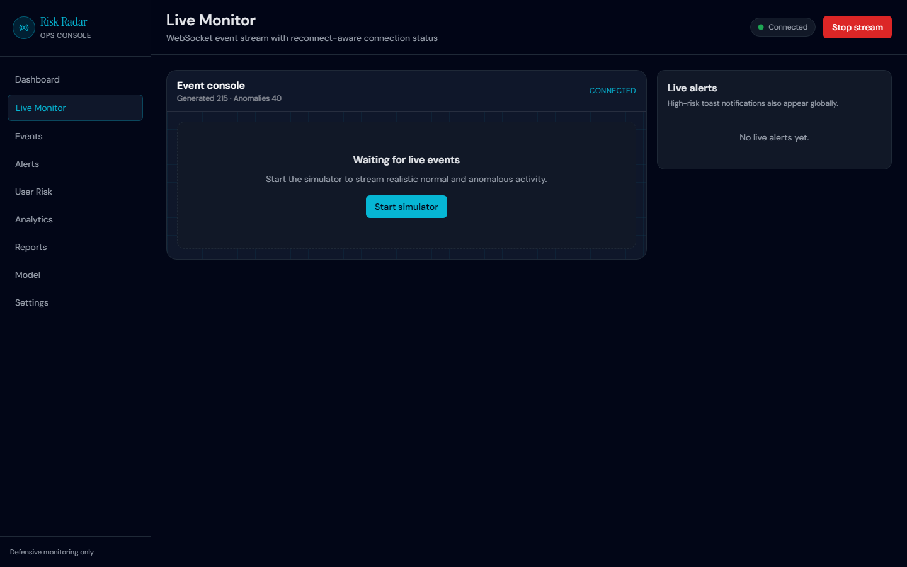
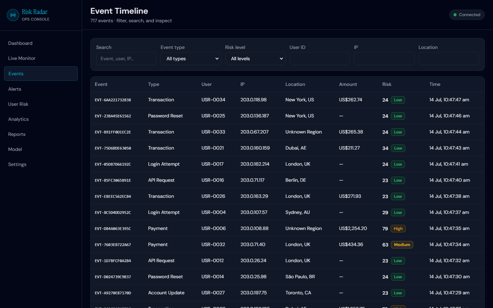
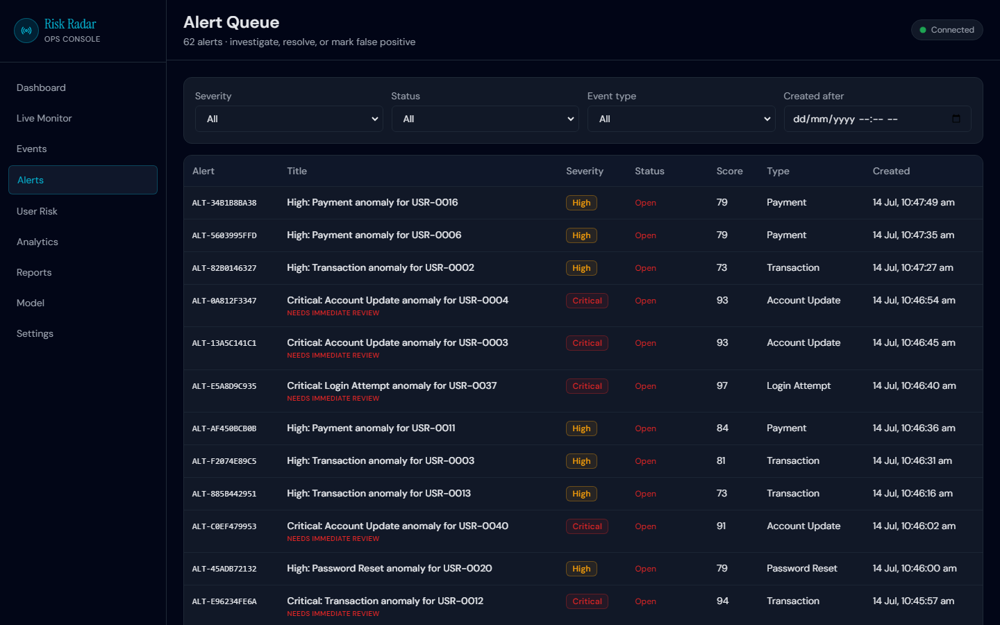
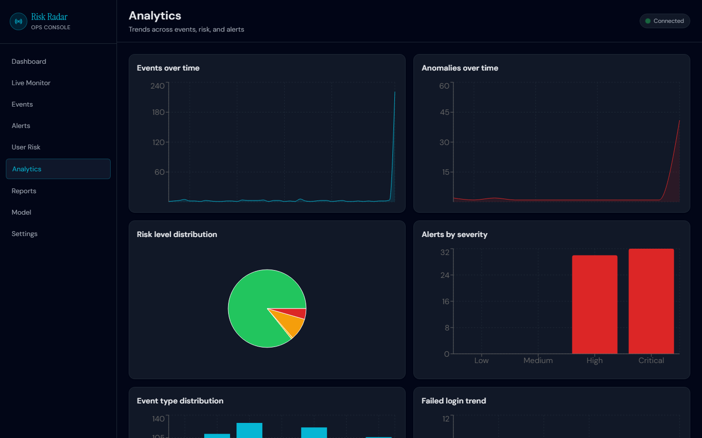
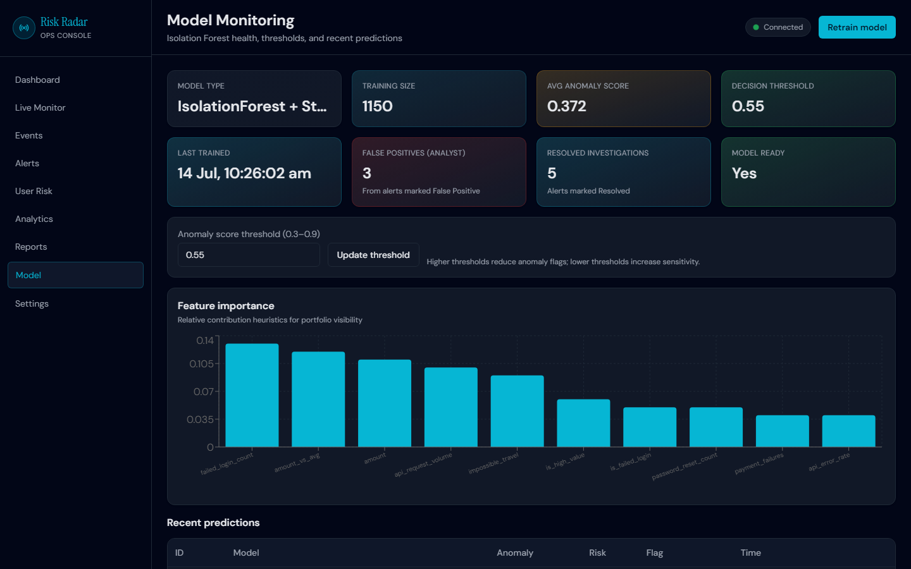
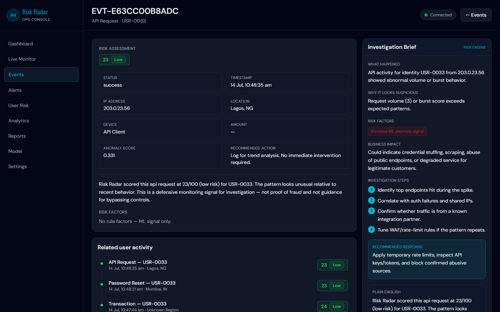

# Real-Time Fraud & Anomaly Detection Dashboard

**Risk Radar** — a production-style portfolio case study for real-time fraud and anomaly detection.

## Short description

A full-stack risk operations console that streams live events over WebSockets, scores anomalies with machine learning and business rules, opens investigation alerts, and generates AI-assisted explanations for analysts.

## Problem

Businesses need to monitor transactions, user activity, payments, logins, API requests, and system events in real time. Manual monitoring is slow and unreliable.

## Solution

This app detects abnormal activity automatically, assigns risk scores, creates alerts, explains anomalies in plain English, and helps teams respond faster through live dashboards, timelines, user risk profiles, analytics, and exportable reports.

## Business value

Real-Time Fraud & Anomaly Detection Dashboard helps businesses detect suspicious activity faster by monitoring transactions, login attempts, payments, API requests, and system events in real time. It combines machine learning, rules-based risk scoring, alerts, WebSocket live updates, and AI-generated explanations to help teams investigate anomalies and reduce operational risk.

## Use cases

| Team | How Risk Radar helps |
| --- | --- |
| **Fintech / banking** | Monitor high-value transfers, impossible travel logins, and account takeover patterns |
| **SaaS trust & safety** | Detect API abuse, credential stuffing, and suspicious account changes |
| **Ecommerce** | Flag unusual payments, shipping/geo mismatches, and repeated payment failures |
| **Cybersecurity SOC** | Stream events into an investigation console with severity-based alert queues |
| **Payment operations** | Hold settlement candidates, review instrument risk, and export audit reports |
| **Platform / ops** | Watch traffic spikes, system anomalies, and model threshold health |

## Key features

- Landing page with Risk Radar brand identity
- Real-time operations dashboard
- WebSocket live event stream + reconnect status
- Background event simulator (start/stop from UI)
- Isolation Forest anomaly detection + rule engine
- Risk scores (1–100) with Low / Medium / High / Critical levels
- Alert investigation workflow + analyst notes
- AI explanations with OpenAI-compatible API or mock fallback
- Event timeline, user risk profiles, analytics, reports (CSV/JSON)
- Model monitoring + synthetic retrain
- Settings for thresholds and simulation tuning
- Optional Docker Compose (frontend, backend, PostgreSQL)

## Real-time event streaming workflow

1. Analyst starts the simulator (or production ingest posts events).
2. Backend analyzes each event (features → ML → rules → risk score).
3. Event is persisted to PostgreSQL/SQLite and broadcast on `/ws/events`.
4. Frontend live monitor / dashboard updates instantly.
5. High/Critical events create alerts and toast notifications.

## ML anomaly detection workflow

1. Feature engineering extracts amount, velocity, geo/device change, IP patterns, API volume, etc.
2. Isolation Forest scores anomaly likelihood.
3. Rule triggers add explainable business-risk points.
4. Combined risk score classifies severity and recommended action.

## Risk scoring workflow

`ML anomaly score` + weighted rule triggers → clamped score `1–100` → risk level → recommended action → optional alert.

## AI explanation workflow

1. For an event, backend builds an investigation brief.
2. If `OPENAI_API_KEY` exists, an OpenAI-compatible chat completion is used.
3. Otherwise a realistic mock explanation is returned.
4. Content stays defensive: investigation and prevention only.

## Tech stack

| Layer | Stack |
| --- | --- |
| Frontend | React, Vite, Tailwind CSS, Axios, React Router, Recharts, WebSocket |
| Backend | FastAPI, SQLAlchemy, Pydantic, WebSockets |
| Data | PostgreSQL (Docker) or SQLite (local demo) |
| ML | Scikit-learn Isolation Forest, Pandas/NumPy |
| AI | OpenAI-compatible API + mock fallback |

## Architecture

```text
[Event Simulator / Ingest]
          |
          v
   [FastAPI Services]
     | features | ML | rules | alerts | AI explanations
          |
   +------+------+
   | PostgreSQL  |<---- seed / reports / profiles
   +------+------+
          |
   [WebSocket /ws/events]
          |
   [React Risk Radar Console]
```

## Screenshots

### Landing



### Operations dashboard



### Live monitor



### Event timeline



### Alert queue



### Analytics



### Model monitoring



### Event details + investigation brief



## Folder structure

```text
real-time-anomaly-detection-dashboard/
├── backend/
│   ├── main.py
│   ├── config.py
│   ├── database.py
│   ├── models.py
│   ├── schemas.py
│   ├── seed.py
│   ├── requirements.txt
│   ├── routes/
│   ├── services/
│   └── utils/
├── frontend/
│   ├── src/
│   │   ├── api/
│   │   ├── components/
│   │   ├── pages/
│   │   └── utils/
│   └── package.json
├── docs/
│   └── screenshots/
├── docker-compose.yml
└── README.md
```

## Setup instructions

### Prerequisites

- Python 3.11+
- Node.js 20+
- Optional: Docker Desktop

### Backend (SQLite demo — fastest)

```bash
cd backend
python -m venv .venv

# Windows PowerShell
.venv\Scripts\Activate.ps1

# macOS/Linux
# source .venv/bin/activate

pip install -r requirements.txt
copy .env.example .env   # or: cp .env.example .env
python seed.py
uvicorn main:app --reload --port 8000
```

If port `8000` is already in use on your machine, start on another port (for example `8800`) and set matching values in `frontend/.env`:

```bash
VITE_API_BASE=http://127.0.0.1:8800
VITE_WS_BASE=ws://127.0.0.1:8800
```

### Frontend

```bash
cd frontend
npm install
# optional: copy .env.example to .env and adjust API/WS URLs
npm run dev
```

Open:
- App: http://localhost:5173
- API docs: http://localhost:8000/docs (or your chosen backend port)

### Docker (PostgreSQL)

```bash
docker compose up --build
```

Then seed runs automatically in the backend container on start.

## Environment variables

| Variable | Purpose |
| --- | --- |
| `DATABASE_URL` | SQLAlchemy URL (`sqlite:///./fraud_detection.db` or Postgres) |
| `CORS_ORIGINS` | Comma-separated allowed origins |
| `JWT_SECRET` | JWT signing secret (auth structure ready) |
| `OPENAI_API_KEY` | Enables live AI explanations |
| `OPENAI_BASE_URL` | OpenAI-compatible base URL |
| `CHAT_MODEL` | Chat model name |

Frontend optional:

| Variable | Purpose |
| --- | --- |
| `VITE_API_BASE` | API origin (default `http://127.0.0.1:8000`) |
| `VITE_WS_BASE` | WebSocket origin (default `ws://127.0.0.1:8000`) |

## API endpoints

- `GET /api/dashboard/stats`
- `GET /api/dashboard/recent-events`
- `GET /api/dashboard/recent-alerts`
- `WS /ws/events`
- `GET /api/events` · `GET /api/events/{id}` · `POST /api/events/analyze`
- `POST /api/events/import-csv` · Risk Radar or PaySim transaction CSV (`file` multipart field; 10 MB / 50,000 row limits)
- `GET /api/alerts` · `PUT /api/alerts/{id}` · resolve / false-positive / notes
- `POST /api/simulator/start|stop` · `GET /api/simulator/status`
- `GET /api/analytics/*`
- `GET|POST /api/reports` · CSV/JSON export
- `GET /api/users/risk-profiles`
- `GET /api/model/status` · `POST /api/model/train`
- `GET|PUT /api/settings`

## Demo workflow

1. Seed the database (`python seed.py`).
2. Start backend + frontend.
3. Open **Live Monitor** and click **Start stream**.
4. Watch anomalies appear; high-risk alerts toast in the UI.
5. Open an event → review AI investigation brief.
6. Update alert status, add analyst notes.
7. Generate a report and export CSV/JSON.
8. Retrain the Isolation Forest on the Model page.

On the Events page, upload a `.csv` using either the Risk Radar columns `event_type,user_id,amount` or PaySim columns `type,amount,nameOrig`. PaySim `isFraud` and `isFlaggedFraud` values are stored as dataset metadata after model inference and are not used as prediction inputs. Import summaries distinguish analyzed, rejected, and model-flagged anomaly rows.

Demo admin (JWT structure): `admin` / `admin123`

## Future improvements

- Real payment processor integration (Stripe/Adyen webhooks)
- Kafka (or similar) event streaming for high-volume ingest
- Redis caching for dashboard aggregates and session risk context
- SIEM integration (Splunk / Elastic / Sentinel export)
- Email / SMS alert notifications for critical severity
- Role-based access control and SSO for analyst roles
- Model drift monitoring and scheduled recalibration jobs
- Production deployment (containers, managed Postgres, CDN frontend)
- XGBoost classifier alongside Isolation Forest
- Native PDF report rendering

## Security note

This system is for **defensive monitoring and investigation only**. It does not provide guidance for committing fraud or bypassing detection controls.

## License

This project is licensed under the [MIT License](LICENSE). Copyright (c) 2026 Asif Fiaz.
